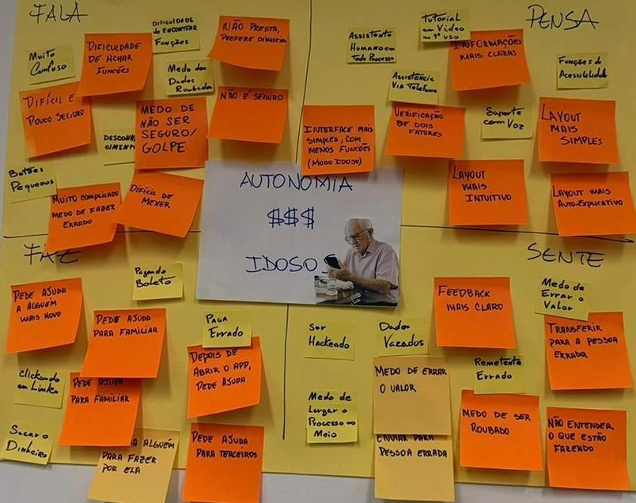

# PIX para todos — Portfólio de IHC

Portfólio acadêmico da disciplina de Introdução à Interação Humano-Computador (UFF · 2026.2).

**Tema:** a dificuldade de idosos não familiarizados com tecnologia em realizar
transferências bancárias via PIX.

## Como abrir

Basta abrir o arquivo `index.html` no navegador. Não há dependências, build ou banco de dados.
O site tem uma página por etapa, ligadas pelo menu lateral (o fio condutor).

## Arquivos

```
index.html               → capa e o caminho do projeto (atalho para cada etapa)
projeto.html             → O Projeto: contexto, problema, público-alvo e objetivo
problema.html … conclusoes.html → uma página por etapa (tabela abaixo)
entrevistas.html         → vídeos, entrevistas em documento e TCLE (dentro da etapa 05)
respostas.html           → tabela com as respostas do questionário (dentro da etapa 06)
equipe.html              → integrantes do grupo
uso-de-ia.html           → relatório de uso de IA
css/styles.css           → estilos, organizado em blocos numerados
js/main.js               → tema, menu lateral, animações, leitor de PDF e vídeos
img/                     → imagens (fotos, gráficos e capas dos PDFs em img/capas/)
docs/                    → PDFs lidos no site (planejamentos, relatórios) e a planilha
```

## Modo claro e escuro

O site tem os dois temas. O botão fica no canto superior direito e a escolha é
salva no navegador (`localStorage`). Na primeira visita, o site segue a preferência
do sistema operacional da pessoa.

As cores dos dois temas ficam no topo do `css/styles.css`:

- bloco `:root` → tema claro
- bloco `:root[data-tema="escuro"]` → tema escuro

Para mudar qualquer cor do site, basta editar essas variáveis — nenhum outro
trecho do CSS precisa ser alterado.

## Como preencher o conteúdo

Todo texto provisório está marcado com `[A PREENCHER]` e a classe `placeholder`
(aparece em cinza, com uma barra à esquerda). Para publicar um conteúdo real,
substitua o texto e remova a classe `placeholder`.

### Como o site está organizado

Cada parte do trabalho tem a sua página. Todas seguem o mesmo molde:

- **Fio condutor** (`<nav class="trilha">`): o menu lateral com todas as páginas.
  As etapas ficam ligadas por uma linha que se preenche até a etapa aberta. O
  número em `data-etapa` diz até onde a linha vai (0 antes da etapa 01, 11
  depois da etapa 10).
  - No computador o menu fica escondido. Na borda esquerda fica só uma linha
    (`<button class="puxador">`): com o mouse em cima o menu aparece, e um
    clique na linha deixa ele fixo na tela (outro clique recolhe). A escolha
    fica salva no navegador.
  - No celular o menu abre pelo botão do cabeçalho.
- **Cabeçalho da página** (`<header class="pagina__cabecalho">`): caminho
  (Início / fase / etapa), número da etapa, título e texto de abertura. Páginas
  longas têm atalhos ("Nesta página") para as partes da página.
- **Conteúdo** (`<div class="pagina__corpo">`).
- **Anterior / Próxima** (`<nav class="paginacao">`): leva para a página vizinha
  na ordem do fio condutor.

O fio condutor é igual em todas as páginas. Se mudar o nome de uma etapa, mude
nas outras páginas também (o item da página atual leva `aria-current="page"`).

### Preencher uma etapa

As etapas 07 a 10 ainda só têm o texto provisório. Para publicar, abra a página
da etapa (por exemplo `ideacao.html`) e troque o `<p class="placeholder">`
pelo conteúdo, dentro do `<div class="pagina__corpo">`. Os blocos usados nas
outras etapas (`analise__grupo`, `arquivo`, `foto` etc.) funcionam em qualquer
página.

### Animações

Os blocos entram subindo quando aparecem na tela, a linha do fio condutor avança
de uma etapa para a outra e a troca entre páginas é suave nos navegadores que
suportam. Quem pediu menos movimento no sistema vê o site sem animações.

### Adicionar uma imagem a uma etapa

Coloque o arquivo em `img/` e use a classe `foto`:

```html
<figure class="foto">
  
  <figcaption>Legenda da imagem.</figcaption>
</figure>
```

### Adicionar um PDF para ler no site

Os PDFs não são baixados: abrem no modo de leitura do próprio site (uma janela
por cima da página, com zoom e contador de páginas). Coloque o PDF em `docs/`,
salve a primeira página como imagem em `img/capas/` e use o cartão `documento`:

```html
<a class="documento" href="docs/nome-do-arquivo.pdf" data-leitor>
  <span class="documento__capa"></span>
  <span class="documento__texto">
    <strong class="documento__titulo">Título do documento</strong>
    <small class="documento__meta">PDF &middot; 5 páginas</small>
    <span class="documento__acao">Ler aqui</span>
  </span>
</a>
```

Sem a imagem de capa (apague o ``), o cartão mostra uma folha em branco.
O leitor usa o PDF.js, carregado do cdnjs só quando alguém abre um documento.

### Adicionar um vídeo das entrevistas

Os vídeos tocam numa tela dentro de `entrevistas.html`. Para cada vídeo,
acrescente um item na lista `videoteca__lista` (o modelo está num comentário
no começo da página). Se o vídeo não deixa ser exibido fora do YouTube, use
`data-incorporar="nao"`: a tela passa a abrir o YouTube. Para liberar, ligue
"Permitir incorporação" no YouTube Studio (Conteúdo, vídeo, Mostrar mais) e
tire o atributo.

### Adicionar um link simples a uma lista

Para um item que não é PDF nem vídeo, use o `doc` dentro de `<ul class="lista-docs">`:

```html
<li>
  <a class="doc" href="LINK" target="_blank" rel="noopener">
    <span class="doc__codigo">P01</span>
    <span class="doc__nome">Nome do material</span>
    <span class="doc__meta">YouTube</span>
  </a>
</li>
```

Quando a lista ganhar o primeiro item, apague o `<p class="placeholder">` da seção.

### Ligar uma certeza da Matriz CSD a uma referência

Cada certeza tem uma etiqueta com o nome da fonte que aponta para a lista de
referências no fim da etapa:

```html
<a class="csd__fonte" href="#ref-csd-1" aria-label="Ver a referência 1: Portal Unit">…</a>
```

O número no `href` é o `id` do item da lista (`<li id="ref-csd-1">`). Para usar
uma nova fonte, basta acrescentar o item na lista com o próximo `id`.

### Adicionar uma nova página

Copie uma página parecida (por exemplo `ideacao.html`), troque o título, o
cabeçalho e o conteúdo, e acrescente o link dela no fio condutor de todas as
páginas. Ajuste também os links de Anterior / Próxima das páginas vizinhas.

## Etapas do processo

| # | Fase | Etapa | Página |
|---|------|-------|--------|
| 01 | Imersão | Definição do problema e How Might We | `problema.html` |
| 02 | Imersão | Matriz CSD | `matriz-csd.html` |
| 03 | Imersão | Mapa de Empatia | `mapa-de-empatia.html` |
| 04 | Imersão | Análise Competitiva | `analise-competitiva.html` |
| 05 | Imersão | Pesquisa com usuários | `pesquisa.html` |
| 06 | Imersão | Análise dos resultados | `resultados.html` |
| 07 | Ideação e prototipação | Ideação | `ideacao.html` |
| 08 | Ideação e prototipação | Solução / Protótipo | `prototipo.html` |
| 09 | Avaliação | Avaliação | `avaliacao.html` |
| 10 | Avaliação | Conclusões | `conclusoes.html` |

Links antigos como `index.html#processo` ou `index.html#equipe` continuam
funcionando: a capa redireciona para a página nova.

## Publicação

O site é publicado pelo GitHub Pages a partir da branch `main` (pasta raiz):
https://uff-arthurmta.github.io/PortofolioIHC/

Todo push para `main` republica o site automaticamente em cerca de um minuto.

O CSS e o JS são chamados com `?v=N` em todas as páginas. Sempre que mudar um
desses arquivos, aumente o número em todas elas — assim o navegador não mostra a
versão antiga guardada em cache.
